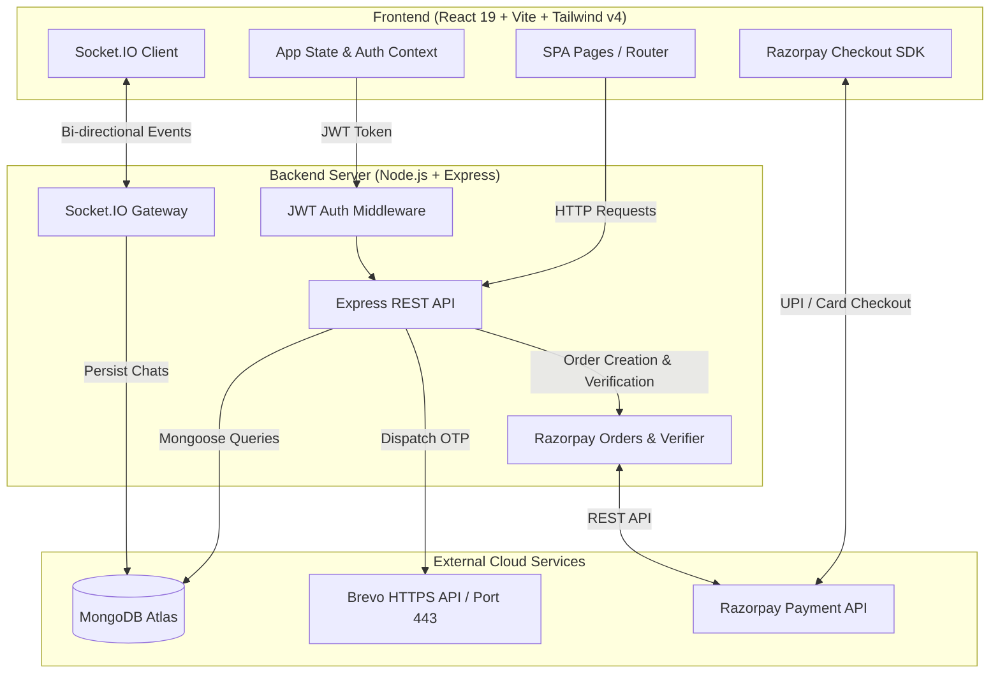

# Academica Exchange (Student Rental Hub)

[](https://nodejs.org/)
[](https://expressjs.com/)
[](https://react.dev/)
[](https://tailwindcss.com/)
[](https://www.mongodb.com/)
[](https://razorpay.com/)
[](https://socket.io/)
[](https://opensource.org/licenses/MIT)

**Academica Exchange** is a full-stack peer-to-peer (P2P) campus rental marketplace exclusively for verified college students (**`@tkmce.ac.in`**). It enables students to rent, borrow, and share essential campus equipment—including textbooks, scientific calculators, mini-drafters, bicycles, and lab equipment—within a secure, high-trust community backed by Razorpay escrow and Brevo email verification.

---

## Table of Contents

- [Key Features](#key-features)
- [System Architecture](#system-architecture)
- [Tech Stack](#tech-stack)
- [Project Directory Structure](#project-directory-structure)
- [Environment Variables](#environment-variables)
- [Getting Started Locally](#getting-started-locally)
- [API Endpoints Reference](#api-endpoints-reference)
- [Razorpay Payment Gateway](#razorpay-payment-gateway)
- [Real-Time Messaging System](#real-time-messaging-system)
- [Email Verification Architecture](#email-verification-architecture)
- [Testing & Smoke Test Suite](#testing--smoke-test-suite)
- [Deployment (Render)](#deployment-render)
- [License](#license)

---

## Key Features

- **College Domain Verification:** Registration is strictly restricted to `@tkmce.ac.in` email addresses with 6-digit OTP email verification via Brevo HTTPS API (Port 443).
- **Dynamic Marketplace & Search:** Filter campus equipment by category (`textbooks`, `electronics`, `cycles`, `furniture`, `utilities`), keyword search, and price range in Indian Rupees (`₹`).
- **Razorpay Payment Gateway & Escrow:** Integrated checkout supporting **UPI (Google Pay, PhonePe, Paytm, BHIM)**, Cards, and NetBanking with cryptographic HMAC SHA-256 signature verification.
- **Lister Payout Preferences:** Listers can specify preferred payout methods (UPI ID, Cash on Handoff, Bank Account).
- **Rental Duration & Deposit Calculator:** Real-time calculation of daily rates (`₹/day`), refundable security deposits, and campus service fees.
- **Dual-Layer Real-Time Messaging:** Integrated messaging with real-time WebSockets (`Socket.IO`) and automated HTTP REST fallbacks. Includes rate negotiation and physical pickup proposals.
- **Interactive User Profile Dropdown:** Streamlined navbar with avatar pill dropdown showing verified credentials, referral balance, active listings, and settings.
- **Student Trust & Campus Safety Hub:** Guidelines, safe meetup zones across campus (Central Library, College Canteen, Mech Block, Main Gate), and peer escrow rules.
- **Profile & Rental Management:** Manage owned gear, track borrowed equipment, update campus bio, and handle rental requests with inline Approve/Reject actions.
- **Campus Referral Program:** Students receive ₹50 referral credits upon inviting verified classmates, redeemable directly during checkout.
- **Automated Smoke Test Suite:** Built-in end-to-end integration test script verifying all 15 core workflows with zero dependencies.

---

## System Architecture



---

## Tech Stack

### Frontend
- **Framework:** React 19 (Hooks, Context API, React Portals)
- **Bundler:** Vite 8
- **Routing:** React Router DOM 7
- **Styling:** Tailwind CSS v4 & PostCSS
- **Payment SDK:** Razorpay Checkout SDK (`v1`)
- **Icons:** Material Symbols Outlined
- **Real-Time Client:** Socket.IO Client 4.8

### Backend
- **Runtime:** Node.js (ES Modules)
- **Framework:** Express 4.19
- **Database & ODM:** MongoDB Atlas & Mongoose 8.3
- **Payments:** Razorpay Node.js SDK & Crypto HMAC verification
- **Authentication:** JWT (JSON Web Tokens) & bcryptjs password hashing
- **Real-Time Gateway:** Socket.IO 4.7
- **Email Delivery:** Brevo HTTPS REST API (Port 443) with Nodemailer SMTP fallback

---

## Project Directory Structure

```text
AWT/
├── backend/
│   ├── config/
│   │   ├── db.js              # MongoDB Atlas connection setup
│   │   └── seed.js            # Initial TKMCE equipment pool seeder
│   ├── middleware/
│   │   └── auth.js            # JWT verification & route protection
│   ├── models/
│   │   ├── Booking.js         # Rental reservation schema (with Razorpay payment fields)
│   │   ├── Conversation.js    # Chat thread schema (participants & listing refs)
│   │   ├── Listing.js         # Equipment items schema (with payment preferences)
│   │   ├── Message.js         # Chat message & proposal schema
│   │   └── User.js            # Student profile schema (with bio, phone & referral)
│   ├── routes/
│   │   ├── auth.js            # Sign up, OTP verify, login, profile edit, clean accounts
│   │   ├── bookings.js        # Rental checkout & booking lifecycle
│   │   ├── chats.js           # Conversation threads & message REST API
│   │   ├── listings.js        # Item CRUD, /mine, & search filter endpoints
│   │   ├── payments.js        # Razorpay order creation & HMAC signature verification
│   │   └── referrals.js       # Referral statistics & credit balances
│   ├── scripts/
│   │   ├── smoke_test.js      # Automated 15-step end-to-end workflow smoke test
│   │   ├── test_api.js        # API endpoint testing script
│   │   └── test_email.js      # Brevo email delivery tester
│   ├── sockets/
│   │   └── chatHandler.js     # Socket.IO room events & message broadcasts
│   ├── utils/
│   │   └── emailService.js    # Brevo HTTPS API & Nodemailer integration
│   ├── package.json
│   └── server.js              # Express app & HTTP/Socket server entry point
│
├── frontend/
│   ├── src/
│   │   ├── components/
│   │   │   └── Navbar.jsx     # Header with Avatar dropdown, mobile drawer, & login modal
│   │   ├── context/
│   │   │   └── AppContext.jsx # Global auth, user session, and cart state
│   │   ├── pages/
│   │   │   ├── Cart.jsx       # Multi-item cart & Razorpay checkout summary
│   │   │   ├── Chat.jsx       # Real-time message thread & meetup proposal UI
│   │   │   ├── CreateListing.jsx # Form to list items with payout options
│   │   │   ├── Landing.jsx    # Hero, trust badges, and category previews
│   │   │   ├── ListingDetail.jsx # Item media, specifications, and date picker
│   │   │   ├── Marketplace.jsx# Product search & category filters
│   │   │   ├── MyProfile.jsx  # Student profile, bio, listings, & borrowed rentals
│   │   │   ├── Notifications.jsx # Actionable rental alerts & payment triggers
│   │   │   ├── Referrals.jsx  # Referral code sharing & credit tracking
│   │   │   ├── settings.jsx   # Account, password, and notification preferences
│   │   │   ├── SignUp.jsx     # Student registration form
│   │   │   ├── studenttrust.jsx # TKMCE Campus Safety & Trust Guide
│   │   │   └── Verification.jsx # 6-digit OTP entry screen
│   │   ├── utils/
│   │   │   └── razorpay.js    # Razorpay Checkout SDK loader & modal execution
│   │   ├── App.jsx            # React route definitions
│   │   ├── index.css          # Tailwind CSS v4 styling & layout tokens
│   │   └── main.jsx           # React DOM root entry point
│   ├── index.html             # Razorpay SDK embed & web fonts
│   ├── package.json
│   └── vite.config.js
│
├── package.json               # Root build orchestration
└── README.md
```

---

## Environment Variables

Create a `.env` file in the `backend/` directory:

```env
PORT=5000
MONGO_URI=mongodb+srv://<username>:<password>@cluster0.mongodb.net/student_rental?retryWrites=true&w=majority
JWT_SECRET=your_jwt_secret_key_here

# Razorpay Gateway (Test Mode / Production)
RAZORPAY_KEY_ID=rzp_test_yourKeyHere
RAZORPAY_KEY_SECRET=yourSecretHere

# Brevo (Sendinblue) HTTPS API (Recommended for Universal Delivery to @tkmce.ac.in)
BREVO_API_KEY=xkeysib-xxxxxxxxxxxxxxxxxxxxxxxxxxxxxxxxxxxxxxxxxxxxxxxx
BREVO_SENDER_EMAIL=your-verified-brevo-sender@gmail.com

# Optional SMTP Fallbacks
SMTP_HOST=smtp.gmail.com
SMTP_PORT=587
SMTP_USER=your-email@gmail.com
SMTP_PASS=your-app-password
```

| Variable | Description | Required |
| :--- | :--- | :--- |
| `PORT` | Backend server port (defaults to 5000) | No |
| `MONGO_URI` | MongoDB connection string (Atlas or local) | **Yes** |
| `JWT_SECRET` | Secret key used to sign JWT auth tokens | **Yes** |
| `RAZORPAY_KEY_ID` | Razorpay Key ID (Test or Live) | Optional (Built-in Demo Fallback) |
| `RAZORPAY_KEY_SECRET` | Razorpay Key Secret | Optional (Built-in Demo Fallback) |
| `BREVO_API_KEY` | Brevo API key for sending OTP emails over Port 443 | **Yes** (in production) |
| `BREVO_SENDER_EMAIL` | Verified sender email configured in Brevo | **Yes** (in production) |

---

## Getting Started Locally

### Prerequisites
- [Node.js](https://nodejs.org/) (v18.0.0 or higher)
- [MongoDB Atlas](https://www.mongodb.com/) cluster or local MongoDB instance

### 1. Clone Repository & Install Dependencies
```bash
git clone https://github.com/Goutham-kc/AWT.git
cd AWT

# Install backend dependencies
npm install --prefix backend

# Install frontend dependencies
npm install --prefix frontend
```

### 2. Configure Environment Variables
Create `backend/.env` with your MongoDB connection string and credentials.

### 3. Build Frontend & Run Server
```bash
# Build the production frontend bundle
npm run build-frontend

# Start the full-stack server
npm start --prefix backend
```

Access the application in your browser:
- **Local Application:** `http://localhost:5000`
- **Initial Seeded Admin/Store:** `campus.store@tkmce.ac.in` (Password: `tkmce123`)

---

## API Endpoints Reference

### Authentication & Profile (`/api/auth`)
| Method | Endpoint | Description | Access |
| :--- | :--- | :--- | :--- |
| `POST` | `/signup` | Register new student (`@tkmce.ac.in` only) | Public |
| `POST` | `/verify-otp` | Verify 6-digit email OTP & activate account | Public |
| `POST` | `/resend-otp` | Resend fresh 6-digit OTP code to email | Public |
| `POST` | `/login` | Authenticate student and issue JWT token | Public |
| `GET`  | `/me` | Get current authenticated user profile | Private |
| `PUT`  | `/profile` | Update name, bio, phone, or password | Private |
| `ALL`  | `/clean-accounts` | Wipe all test accounts and collections (development) | Public |

### Listings (`/api/listings`)
| Method | Endpoint | Description | Access |
| :--- | :--- | :--- | :--- |
| `GET`  | `/` | Retrieve all listings (supports `category`, `campus`, `search`) | Public |
| `GET`  | `/mine` | Retrieve listings created by the logged-in user | Private |
| `GET`  | `/:id` | Get single listing detail with lister profile | Public |
| `POST` | `/` | Create a new equipment listing with payout details | Private |
| `PUT`  | `/:id` | Update an existing listing | Private |
| `DELETE`| `/:id` | Delete a listing | Private |

### Bookings (`/api/bookings`)
| Method | Endpoint | Description | Access |
| :--- | :--- | :--- | :--- |
| `POST` | `/cart/validate` | Validate date conflicts and recompute fees | Private |
| `POST` | `/request` | Submit a rental booking request | Private |
| `GET`  | `/my-rentals` | Get active rentals requested by user | Private |
| `GET`  | `/my-bookings` | Get rental requests received by lister | Private |
| `PUT`  | `/:id/status` | Approve or reject a booking request | Private |

### Razorpay Payments (`/api/payments`)
| Method | Endpoint | Description | Access |
| :--- | :--- | :--- | :--- |
| `GET`  | `/config` | Get public Razorpay key ID and configuration state | Public |
| `POST` | `/create-order` | Create an official Razorpay order in paise (`INR`) | Private |
| `POST` | `/verify` | Verify HMAC SHA-256 signature and mark booking paid | Private |

### Chat & Messaging (`/api/chats`)
| Method | Endpoint | Description | Access |
| :--- | :--- | :--- | :--- |
| `GET`  | `/conversations` | List conversation threads of current user | Private |
| `POST` | `/conversations` | Open or find conversation with a seller | Private |
| `GET`  | `/conversations/:id/messages` | Get message history in thread | Private |
| `POST` | `/conversations/:id/messages` | Send message via REST API & broadcast | Private |

### Referrals (`/api/referrals`)
| Method | Endpoint | Description | Access |
| :--- | :--- | :--- | :--- |
| `GET`  | `/summary` | Get referral code, credits balance, and invitees | Private |

---

## Razorpay Payment Gateway

The application provides end-to-end checkout with Razorpay:

1. **Order Creation:** When a student checks out in [`Cart.jsx`](frontend/src/pages/Cart.jsx) or pays an approved rental, the backend converts the amount into paise (`amount * 100`) and calls `razorpay.orders.create()`.
2. **Checkout Modal:** The Razorpay Checkout SDK displays native Indian payment methods:
   - **UPI:** Google Pay, PhonePe, Paytm, BHIM, and UPI Intent.
   - **Cards & NetBanking:** Visa, MasterCard, RuPay, and major Indian banks.
3. **Cryptographic Verification:** Upon successful payment, the frontend sends `razorpay_order_id`, `razorpay_payment_id`, and `razorpay_signature` to `/api/payments/verify`. The server verifies the signature using:
   ```javascript
   crypto.createHmac('sha256', secret).update(order_id + '|' + payment_id).digest('hex')
   ```
4. **Chat Audit Log:** Once verified, the booking is flagged as `paid` and an automated system receipt is posted directly into the renter-lister chat thread.
5. **Built-in Demo Fallback:** If personal Razorpay keys are not yet configured in `.env`, the system automatically runs in simulated verification mode, allowing you to test the complete checkout flow immediately without errors.

---

## Real-Time Messaging System

The messaging architecture combines **Socket.IO** with an **Express REST fallback**:

1. **Dual Delivery:** Sending a message posts to `POST /api/chats/conversations/:id/messages`. The backend saves the document to MongoDB, updates the thread's last message, and broadcasts `new_message` to the Socket room. If WebSockets are reconnecting or blocked, the REST fallback ensures zero lost messages.
2. **Room Management:** When opening a thread, the client emits `join_conversation`. Sockets automatically route updates only to authorized thread participants.
3. **Structured Proposals:** Supports price negotiation (`price_proposal`) and physical pickup proposals (`meetup_proposal`), allowing peers to settle terms directly inside the chat window.

---

## Email Verification Architecture

```text
Student Enters Email (@tkmce.ac.in)
              │
              ▼
Backend generates 6-digit OTP (15-min expiry)
              │
              ├──► 1. Brevo HTTPS API (https://api.brevo.com/v3/smtp/email)
              │    - Uses standard Outbound HTTPS Port 443
              │    - Bypasses cloud host SMTP port restrictions
              │    - Delivers directly to @tkmce.ac.in inbox
              │
              └──► 2. Nodemailer SMTP Fallback
```

Free-tier hosting providers (e.g., Render, Railway) block outbound SMTP ports (25, 465, 587) to prevent spam. The Brevo HTTPS API communicates via standard **Port 443**, guaranteeing reliable OTP delivery directly to student college inboxes without port blocking or DNS domain verification restrictions.

---

## Testing & Smoke Test Suite

An automated end-to-end smoke test suite is included in [`backend/scripts/smoke_test.js`](backend/scripts/smoke_test.js) verifying 15 core workflows:

```bash
# Run full automated smoke test
node backend/scripts/smoke_test.js
```

The smoke test validates:
- Server health & public listing queries
- Renter and Lister signup with `@tkmce.ac.in` validation
- OTP verification & automatic JWT issue
- Profile retrieval and bio updating
- Listing creation with UPI payment options
- Lister's `/mine` catalog endpoint
- Cart date collision validation
- Booking request creation & P2P chat room instantiation
- Razorpay order creation & signature verification
- Lister booking approval
- Bidirectional P2P chat messaging
- Referral summary & credit tracking

---

## Deployment (Render)

1. Connect your repository to [Render](https://render.com/).
2. Select **Web Service** with runtime **Node**.
3. **Build Command:**
   ```bash
   npm run build
   ```
4. **Start Command:**
   ```bash
   npm start
   ```
5. **Environment Variables:**
   - `MONGO_URI`: Your MongoDB Atlas connection string.
   - `JWT_SECRET`: Random 32+ character string.
   - `RAZORPAY_KEY_ID`: Your Razorpay Key ID.
   - `RAZORPAY_KEY_SECRET`: Your Razorpay Key Secret.
   - `BREVO_API_KEY`: Your Brevo API key.
   - `BREVO_SENDER_EMAIL`: Your verified Brevo sender email.
6. Push to `main` branch to trigger automatic builds and zero-downtime deployment.

---

## License

This project was developed as part of the Academic Web Technology (AWT) curriculum for **TKM College of Engineering (TKMCE)**. Distributed under the **MIT License**.
